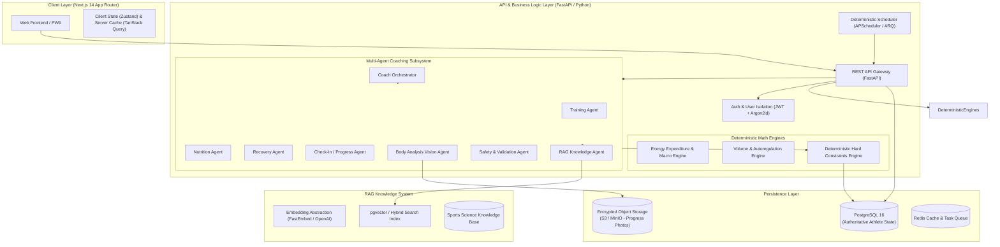
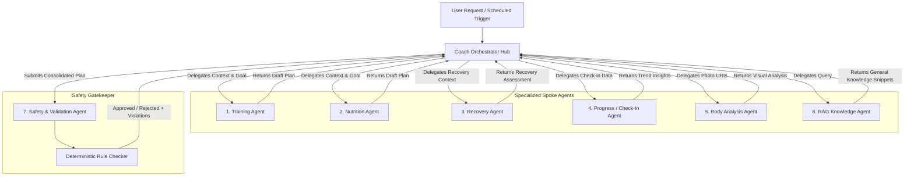
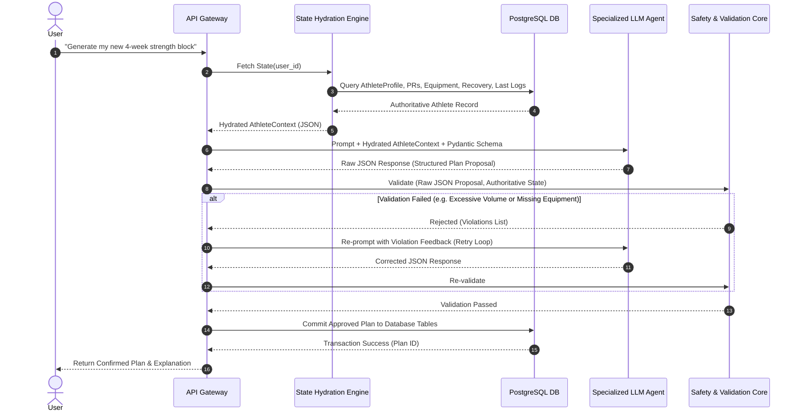
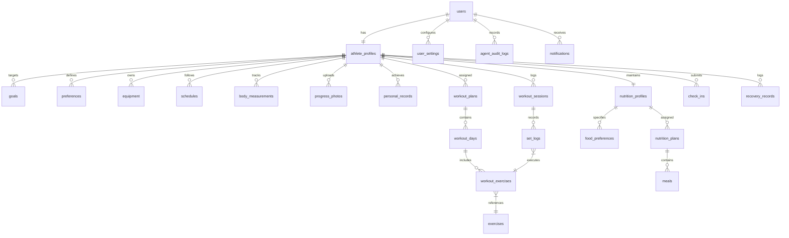
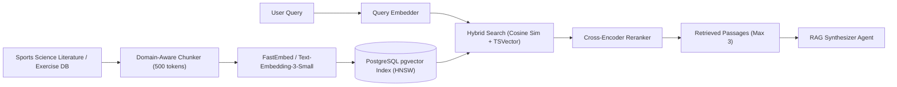
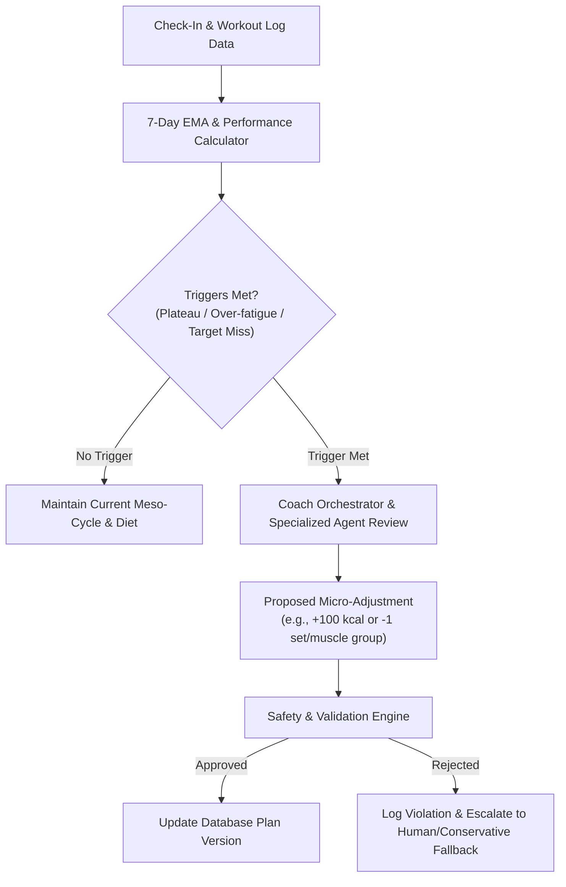
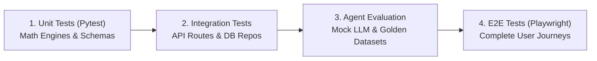
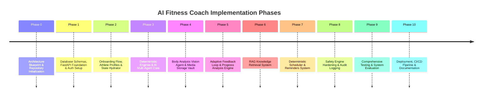

# Comprehensive Technical Architecture & Implementation Blueprint
# AI Fitness Coach: Production-Grade Personalized Fitness & Athletic Coaching Platform

**Document Version:** 1.0.0  
**Author:** Lead Software Architect & Autonomous Development Engineer  
**Status:** Approved Architectural Blueprint  
**Target System:** AI Fitness Coach (Final Year Project & Production Platform)

---

## 1. Executive Summary

### 1.1 Vision & Purpose
**AI Fitness Coach** is an intelligent, hyper-personalized, persistent athletic coaching platform. Designed to emulate the real-world methodology of elite strength & conditioning coaches and clinical sports dietitians, the platform provides end-to-end fitness management—from structured onboarding and multimodal progress analysis to adaptive periodized workout plans and constraint-aware nutrition.

Unlike consumer AI wrappers that rely on transient LLM chat sessions, **AI Fitness Coach** strictly separates AI reasoning from persistent athlete state. The system operates as a hybrid platform: combining deterministic scientific calculation engines (for energy expenditure, progressive overload thresholds, and safety limits) with specialized LLM/Vision agents (for qualitative feedback, program synthesis, and unstructured interaction).

### 1.2 Core Architectural Principles
1. **Database as Authoritative Source of Truth:** The system NEVER relies on LLM conversational memory for athlete facts (age, weight, PRs, injuries, or preferences). All athlete data is stored in PostgreSQL with strict schemas and temporal versioning.
2. **Anti-Hallucination Pipeline:** Every AI request follows a unidirectional pipeline:  
   $$\text{Database} \longrightarrow \text{State Hydration} \longrightarrow \text{Specialized Agent} \longrightarrow \text{Structured Schema} \longrightarrow \text{Validation Core} \longrightarrow \text{Database Commit}$$
3. **Hub-and-Spoke Multi-Agent Architecture:** A central `Coach Orchestrator` coordinates seven domain-specific agents (`Training`, `Nutrition`, `Recovery`, `Check-in`, `Body Analysis`, `Safety/Validation`, `RAG Knowledge`).
4. **Deterministic Math Over Stochastic Estimation:** All numerical macro allocations, TDEE estimates, volume limits, and linear progressions are calculated deterministically. LLMs handle qualitative formatting, context integration, and adaptive meal/exercise selection within deterministic boundaries.
5. **Explicit Uncertainty in Computer Vision:** Visual progress and body composition assessments explicitly communicate estimation uncertainty and qualitative observations rather than presenting fake precision (e.g., claiming "13.74% body fat").
6. **Safety First & Medical Non-Interference:** Automated rule engines evaluate all generated plans for extreme deficits, excessive volume, or dangerous biomechanical pairings, escalating potential health risks to human professional care.

---

## 2. System Architecture

### 2.1 High-Level Architecture Overview
The platform is structured as a **Modular Monolith** designed for high developer productivity, effortless local execution, clean component isolation, and straightforward cloud deployment.



### 2.2 Core Subsystem Responsibilities
- **Frontend App Router:** Serves responsive UI, workout execution logs, meal planners, interactive progress graphs, and AI Coach interface.
- **FastAPI Core Service:** Handles HTTP routing, middleware validation, database transactions, background task orchestration, and JWT user session control.
- **Deterministic Math Engines:** Pure Python functions for BMR (Mifflin-St Jeor / Katch-McArdle), target macro distribution, 1RM estimates (Epley/Brzycki formula), volume landmines, and 7-day weight trend moving averages.
- **Multi-Agent Orchestrator:** Dispatches user prompts to specialized domain agents, hydrates agent context with authoritative database records, and parses structured output formats (Pydantic v2).
- **PostgreSQL 16 Storage Engine:** Enforces relational integrity, stores user profiles, workout logs, nutrition history, audit records, and pgvector embeddings.
- **Encrypted Media Vault:** Stores progress photos with AES-256 server-side encryption, serving temporal presigned URLs with 15-minute expiration.

---

## 3. Component Architecture

### 3.1 Backend Component Breakdown

```mermaid
componentDiagram
    package "FastAPI Application Core" {
        [API Routes Module] --> [Auth & Security Core]
        [API Routes Module] --> [Athlete State Hydrator]
        [Athlete State Hydrator] --> [Database Repository Layer]
        
        [API Routes Module] --> [Coach Orchestrator]
        
        package "Services & Engines" {
            [Coach Orchestrator] --> [Training Service]
            [Coach Orchestrator] --> [Nutrition Service]
            [Coach Orchestrator] --> [CheckIn Service]
            [Coach Orchestrator] --> [Body Analysis Service]
            
            [Training Service] --> [Deterministic Overload Engine]
            [Nutrition Service] --> [Deterministic Macro Engine]
            [Services & Engines] --> [Validation Core Engine]
        }
        
        package "Agent Execution Engine" {
            [Coach Orchestrator] --> [Agent Runner Pipeline]
            [Agent Runner Pipeline] --> [LLM Provider Abstraction]
            [Agent Runner Pipeline] --> [Structured Output Parser]
        }
    }
    
    package "External Systems" {
        [Database Repository Layer] --> [PostgreSQL DB]
        [LLM Provider Abstraction] --> [OpenAI / Anthropic / Gemini API]
        [Body Analysis Service] --> [S3 Encrypted Object Store]
        [Services & Engines] --> [Redis / ARQ Worker Queue]
    }
```

### 3.2 Decoupling & Interface Contracts
To guarantee that AI components can be updated, swapped, or benchmarked without breaking application state:
- **Repository Pattern:** All database queries are isolated inside typed async repositories (`AthleteRepository`, `WorkoutRepository`, `NutritionRepository`).
- **Engine Isolation:** Deterministic math engines take pure primitive types or domain schemas and return typed result structs with zero LLM/API dependencies.
- **Agent Contract:** Every agent receives a `HydratedAthleteState` model and returns a Pydantic `AgentOutputEnvelope` containing structured actions, plain-text explanations, and confidence metadata.

---

## 4. Multi-Agent Architecture

### 4.1 Hub-and-Spoke Topology
The multi-agent system uses a strictly controlled **Hub-and-Spoke pattern** led by the `Coach Orchestrator`. Spoke agents never communicate directly with each other; all cross-domain synthesis passes back through the Orchestrator for safety auditing.



### 4.2 Deterministic Engines vs. LLM Agents Matrix

| Capability / Task | Component Type | Implementation Technology | Rationale |
| :--- | :--- | :--- | :--- |
| **BMR / TDEE Calculation** | Deterministic Engine | Python (`Mifflin-St Jeor`) | Math must be exact and 100% reproducible. |
| **Macro Allocation** | Deterministic Engine | Python Rules | Protein (g/kg), Fat (%), Carbs (remainder). |
| **Linear Progression & 1RM** | Deterministic Engine | Epley/Brzycki Formulations | Precise weight increases based on RPE/RIR logs. |
| **Weekly Weight Moving Average** | Deterministic Engine | 7-day Exponential Smoothing | Prevents reacting to 1-day water fluctuations. |
| **Hard Safety Boundaries** | Deterministic Engine | Pydantic Validators | Guarantees minimum calories & volume caps. |
| **Task & Notification Timing** | Deterministic Engine | APScheduler / Redis | Deterministic cron triggers; never trusts LLM memory. |
| **Intent Classification & Routing** | LLM Agent | `Coach Orchestrator` | Flexible mapping of user intent to sub-agents. |
| **Workout Plan Construction** | LLM Agent | `Training Agent` | Exercise selection matching user equipment & preferences. |
| **Meal Plan Personalization** | LLM Agent | `Nutrition Agent` | Creates meals matching exact macro targets & budget. |
| **Progress Photo Analysis** | Vision Agent | `Body Analysis Agent` | Multimodal qualitative posture & muscle symmetry evaluation. |
| **Domain Knowledge Retrieval** | RAG Agent | `pgvector` + LLM Synthesizer | Fetches evidence-based sports science answers. |

---

## 5. Agent Responsibilities & Specification

### 5.1 Coach Orchestrator
- **Primary Function:** Routes user queries, retrieves authoritative database state, coordinates sub-agent execution, synthesizes multi-domain responses, and manages conversation flow.
- **Inputs:** Raw user prompt, conversation context, `user_id`.
- **Outputs:** `OrchestrationPlan` (JSON containing target agents to invoke and retrieved state subset).
- **Constraints:** Cannot generate workout or diet plans directly; MUST delegate to specialized agents. Cannot mutate DB directly.

### 5.2 Training Agent
- **Primary Function:** Generates periodized meso-cycles, weekly routines, exercise pairings, load recommendations, RPE guidance, and exercise substitutions.
- **Inputs:** `AthleteProfile`, `TrainingPreferences`, `EquipmentList`, `PersonalRecords`, `RecentWorkoutLogs`, `RecoveryScore`.
- **Outputs:** `StructuredWorkoutPlan` (JSON schema containing exercises, sets, reps, target RPE, rest intervals, tempo, progression rules).
- **Constraints:** Must respect available equipment, schedule restrictions, and maximum volume caps provided by the `Safety Engine`.

### 5.3 Nutrition Agent
- **Primary Function:** Generates meal plans, recipes, and dietary adjustments matching target macros and user constraints (budget, foods available, cultural preferences).
- **Inputs:** `TargetMacros` (from Deterministic Engine), `FoodPreferences`, `BudgetTier`, `MealFrequency`, `AllergiesRestrictions`, `AdherenceLog`.
- **Outputs:** `StructuredNutritionPlan` (JSON containing daily meal breakdowns, ingredients, preparation steps, grocery list, budget breakdown).
- **Constraints:** Cannot alter macro totals calculated by the Deterministic Engine by more than $\pm 2\%$. Must enforce 100% exclusion of user allergies.

### 5.4 Recovery Agent
- **Primary Function:** Analyzes sleep duration/quality, subjective fatigue, DOMS, stress logs, and HRV (if available) to calculate daily readiness score and recommend training modifications.
- **Inputs:** `DailyCheckInLogs`, `SleepLogs`, `WorkloadRatio` (Acute vs Chronic Workload Ratio - ACWR).
- **Outputs:** `RecoveryAssessment` (Readiness score 1–100, Deload recommendation flag, intensity modifier $\pm 10-20\%$).
- **Constraints:** Medical disclaimer required. Cannot diagnose injuries or overtraining syndrome; must recommend professional clinical consultation when severe symptoms persist.

### 5.5 Progress / Check-In Agent
- **Primary Function:** Processes daily/weekly check-ins, evaluates 7-day weight trends, calculates adherence scores, and identifies performance plateaus.
- **Inputs:** `WeightLogs`, `MeasurementLogs`, `AdherenceHistory`, `WorkoutPerformanceTrends`.
- **Outputs:** `TrendAnalysisReport` (Weight velocity kg/week, plateau alert flag, recommended macro/volume adjustment triggers).
- **Constraints:** Ignores single-day weight spikes (< 48h). Uses exponential moving average trends for decision triggers.

### 5.6 Body Analysis Agent (Multimodal Vision)
- **Primary Function:** Evaluates front/side/back progress photos for qualitative muscular development, posture alignment, symmetry, and visual progress over time.
- **Inputs:** `CurrentPhotoURIs`, `HistoricalPhotoURIs`, `AthleteMetadata` (Height, Weight, Sex).
- **Outputs:** `VisualProgressAnalysis` (Qualitative development observations, posture notes, visual symmetry assessment, uncertainty disclaimer).
- **Constraints:** NEVER outputs precise numerical body fat percentage (e.g. "14.2%"). Must use qualitative confidence ranges (e.g., "Visually estimated around 14-17% range with moderate uncertainty").

### 5.7 Safety & Validation Agent
- **Primary Function:** Evaluates generated workout and nutrition plans against safety rules, biomechanical principles, and health constraints before plans reach the user.
- **Inputs:** `ProposedWorkoutPlan`, `ProposedNutritionPlan`, `AthleteHealthHistory`.
- **Outputs:** `ValidationResult` (`is_valid`: bool, `violations`: list of strings, `remediation_instructions`: string).
- **Constraints:** Rejects any diet below 1200 kcal/day (female) or 1500 kcal/day (male), or any workout exceeding 30 sets/muscle group/week.

---

## 6. Data Flow Architecture & Anti-Hallucination Pipeline

### 6.1 Strict Anti-Hallucination Pipeline
To prevent AI hallucination from corrupting user plans or inventing non-existent athlete records, data flow MUST execute in a unidirectionally validated loop:



---

## 7. Database ER / Schema Design

### 7.1 Entity-Relationship Diagram



### 7.2 Core Relational DDL (PostgreSQL 16)

```sql
-- Enable Extensions
CREATE EXTENSION IF NOT EXISTS "uuid-ossp";
CREATE EXTENSION IF NOT EXISTS "vector";

-- 1. Users Table
CREATE TABLE users (
    id UUID PRIMARY KEY DEFAULT uuid_generate_v4(),
    email VARCHAR(255) UNIQUE NOT NULL,
    hashed_password VARCHAR(255) NOT NULL,
    full_name VARCHAR(100) NOT NULL,
    is_active BOOLEAN DEFAULT TRUE NOT NULL,
    is_verified BOOLEAN DEFAULT FALSE NOT NULL,
    created_at TIMESTAMPTZ DEFAULT CURRENT_TIMESTAMP NOT NULL,
    updated_at TIMESTAMPTZ DEFAULT CURRENT_TIMESTAMP NOT NULL
);

-- 2. Athlete Profiles Table
CREATE TABLE athlete_profiles (
    id UUID PRIMARY KEY DEFAULT uuid_generate_v4(),
    user_id UUID UNIQUE NOT NULL REFERENCES users(id) ON DELETE CASCADE,
    age INT NOT NULL CHECK (age >= 13 AND age <= 100),
    sex VARCHAR(20) NOT NULL CHECK (sex IN ('male', 'female', 'other')),
    height_cm NUMERIC(5, 2) NOT NULL CHECK (height_cm > 50 AND height_cm < 300),
    current_weight_kg NUMERIC(5, 2) NOT NULL CHECK (current_weight_kg > 20 AND current_weight_kg < 500),
    timezone VARCHAR(50) DEFAULT 'UTC' NOT NULL,
    training_experience_years NUMERIC(4, 1) DEFAULT 0.0 NOT NULL,
    activity_level VARCHAR(30) NOT NULL CHECK (activity_level IN ('sedentary', 'lightly_active', 'moderately_active', 'very_active', 'extra_active')),
    occupation_type VARCHAR(50),
    created_at TIMESTAMPTZ DEFAULT CURRENT_TIMESTAMP NOT NULL,
    updated_at TIMESTAMPTZ DEFAULT CURRENT_TIMESTAMP NOT NULL
);

-- 3. Goals Table
CREATE TABLE goals (
    id UUID PRIMARY KEY DEFAULT uuid_generate_v4(),
    athlete_profile_id UUID NOT NULL REFERENCES athlete_profiles(id) ON DELETE CASCADE,
    primary_goal VARCHAR(50) NOT NULL CHECK (primary_goal IN ('fat_loss', 'muscle_gain', 'strength', 'powerlifting', 'bodybuilding', 'sports_performance', 'general_fitness')),
    target_weight_kg NUMERIC(5, 2),
    target_date DATE,
    sport_name VARCHAR(100),
    sport_position VARCHAR(50),
    is_active BOOLEAN DEFAULT TRUE NOT NULL,
    created_at TIMESTAMPTZ DEFAULT CURRENT_TIMESTAMP NOT NULL
);

-- 4. Exercises Master Table
CREATE TABLE exercises (
    id UUID PRIMARY KEY DEFAULT uuid_generate_v4(),
    name VARCHAR(150) UNIQUE NOT NULL,
    category VARCHAR(50) NOT NULL CHECK (category IN ('barbell', 'dumbbell', 'machine', 'bodyweight', 'cables', 'cardio', 'other')),
    primary_muscle_group VARCHAR(50) NOT NULL,
    secondary_muscles TEXT[] DEFAULT '{}',
    equipment_required VARCHAR(50) NOT NULL,
    movement_pattern VARCHAR(50) NOT NULL CHECK (movement_pattern IN ('squat', 'hinge', 'horizontal_push', 'horizontal_pull', 'vertical_push', 'vertical_pull', 'carry', 'isolation')),
    instructions TEXT,
    created_at TIMESTAMPTZ DEFAULT CURRENT_TIMESTAMP NOT NULL
);

-- 5. Workout Plans Table
CREATE TABLE workout_plans (
    id UUID PRIMARY KEY DEFAULT uuid_generate_v4(),
    athlete_profile_id UUID NOT NULL REFERENCES athlete_profiles(id) ON DELETE CASCADE,
    name VARCHAR(150) NOT NULL,
    description TEXT,
    duration_weeks INT NOT NULL CHECK (duration_weeks > 0 AND duration_weeks <= 52),
    is_active BOOLEAN DEFAULT TRUE NOT NULL,
    version INT DEFAULT 1 NOT NULL,
    generated_by_agent VARCHAR(50) DEFAULT 'TrainingAgent' NOT NULL,
    created_at TIMESTAMPTZ DEFAULT CURRENT_TIMESTAMP NOT NULL
);

-- 6. Workout Days Table
CREATE TABLE workout_days (
    id UUID PRIMARY KEY DEFAULT uuid_generate_v4(),
    workout_plan_id UUID NOT NULL REFERENCES workout_plans(id) ON DELETE CASCADE,
    day_number INT NOT NULL CHECK (day_number BETWEEN 1 AND 7),
    name VARCHAR(100) NOT NULL, -- e.g., "Push A", "Lower Body Strength"
    target_focus VARCHAR(100) NOT NULL,
    created_at TIMESTAMPTZ DEFAULT CURRENT_TIMESTAMP NOT NULL
);

-- 7. Workout Exercises Table
CREATE TABLE workout_exercises (
    id UUID PRIMARY KEY DEFAULT uuid_generate_v4(),
    workout_day_id UUID NOT NULL REFERENCES workout_days(id) ON DELETE CASCADE,
    exercise_id UUID NOT NULL REFERENCES exercises(id) ON DELETE RESTRICT,
    order_in_workout INT NOT NULL,
    target_sets INT NOT NULL CHECK (target_sets > 0),
    target_rep_range_min INT NOT NULL,
    target_rep_range_max INT NOT NULL,
    target_rpe NUMERIC(3, 1) CHECK (target_rpe >= 5.0 AND target_rpe <= 10.0),
    rest_seconds INT DEFAULT 90 NOT NULL,
    tempo VARCHAR(10) DEFAULT '2-0-1-0',
    notes TEXT
);

-- 8. Workout Sessions Log Table
CREATE TABLE workout_sessions (
    id UUID PRIMARY KEY DEFAULT uuid_generate_v4(),
    athlete_profile_id UUID NOT NULL REFERENCES athlete_profiles(id) ON DELETE CASCADE,
    workout_day_id UUID REFERENCES workout_days(id) ON DELETE SET NULL,
    started_at TIMESTAMPTZ NOT NULL,
    completed_at TIMESTAMPTZ,
    session_rpe NUMERIC(3, 1) CHECK (session_rpe BETWEEN 1 AND 10),
    user_notes TEXT,
    created_at TIMESTAMPTZ DEFAULT CURRENT_TIMESTAMP NOT NULL
);

-- 9. Set Logs Table
CREATE TABLE set_logs (
    id UUID PRIMARY KEY DEFAULT uuid_generate_v4(),
    workout_session_id UUID NOT NULL REFERENCES workout_sessions(id) ON DELETE CASCADE,
    workout_exercise_id UUID NOT NULL REFERENCES workout_exercises(id) ON DELETE RESTRICT,
    set_number INT NOT NULL,
    weight_kg NUMERIC(6, 2) NOT NULL,
    reps_completed INT NOT NULL CHECK (reps_completed >= 0),
    actual_rpe NUMERIC(3, 1) CHECK (actual_rpe BETWEEN 5.0 AND 10.0),
    is_warmup BOOLEAN DEFAULT FALSE NOT NULL,
    created_at TIMESTAMPTZ DEFAULT CURRENT_TIMESTAMP NOT NULL
);

-- 10. Nutrition Profiles & Targets Table
CREATE TABLE nutrition_profiles (
    id UUID PRIMARY KEY DEFAULT uuid_generate_v4(),
    athlete_profile_id UUID UNIQUE NOT NULL REFERENCES athlete_profiles(id) ON DELETE CASCADE,
    bmr_kcal INT NOT NULL,
    tdee_kcal INT NOT NULL,
    target_calories INT NOT NULL,
    protein_grams INT NOT NULL,
    carbs_grams INT NOT NULL,
    fat_grams INT NOT NULL,
    weekly_food_budget_amount NUMERIC(10, 2),
    currency_code VARCHAR(3) DEFAULT 'INR' NOT NULL,
    meals_per_day INT DEFAULT 4 NOT NULL CHECK (meals_per_day BETWEEN 1 AND 8),
    created_at TIMESTAMPTZ DEFAULT CURRENT_TIMESTAMP NOT NULL,
    updated_at TIMESTAMPTZ DEFAULT CURRENT_TIMESTAMP NOT NULL
);

-- 11. Food Preferences Table
CREATE TABLE food_preferences (
    id UUID PRIMARY KEY DEFAULT uuid_generate_v4(),
    nutrition_profile_id UUID NOT NULL REFERENCES nutrition_profiles(id) ON DELETE CASCADE,
    food_name VARCHAR(150) NOT NULL,
    preference_type VARCHAR(30) NOT NULL CHECK (preference_type IN ('liked', 'disliked', 'allergic', 'avoided', 'staple')),
    created_at TIMESTAMPTZ DEFAULT CURRENT_TIMESTAMP NOT NULL
);

-- 12. Nutrition Plans Table
CREATE TABLE nutrition_plans (
    id UUID PRIMARY KEY DEFAULT uuid_generate_v4(),
    nutrition_profile_id UUID NOT NULL REFERENCES nutrition_profiles(id) ON DELETE CASCADE,
    name VARCHAR(150) NOT NULL,
    is_active BOOLEAN DEFAULT TRUE NOT NULL,
    version INT DEFAULT 1 NOT NULL,
    created_at TIMESTAMPTZ DEFAULT CURRENT_TIMESTAMP NOT NULL
);

-- 13. Meals Table
CREATE TABLE meals (
    id UUID PRIMARY KEY DEFAULT uuid_generate_v4(),
    nutrition_plan_id UUID NOT NULL REFERENCES nutrition_plans(id) ON DELETE CASCADE,
    meal_number INT NOT NULL,
    name VARCHAR(100) NOT NULL,
    time_of_day VARCHAR(20),
    target_calories INT NOT NULL,
    protein_g INT NOT NULL,
    carbs_g INT NOT NULL,
    fat_g INT NOT NULL,
    recipe_instructions TEXT,
    ingredients JSONB NOT NULL, -- Detailed ingredient breakdown
    created_at TIMESTAMPTZ DEFAULT CURRENT_TIMESTAMP NOT NULL
);

-- 14. Check-Ins Table
CREATE TABLE check_ins (
    id UUID PRIMARY KEY DEFAULT uuid_generate_v4(),
    athlete_profile_id UUID NOT NULL REFERENCES athlete_profiles(id) ON DELETE CASCADE,
    check_in_date DATE NOT NULL,
    weight_kg NUMERIC(5, 2) NOT NULL,
    energy_score INT CHECK (energy_score BETWEEN 1 AND 10),
    sleep_hours NUMERIC(3, 1) CHECK (sleep_hours BETWEEN 0 AND 24),
    sleep_quality_score INT CHECK (sleep_quality_score BETWEEN 1 AND 10),
    stress_score INT CHECK (stress_score BETWEEN 1 AND 10),
    soreness_score INT CHECK (soreness_score BETWEEN 1 AND 10),
    hydration_liters NUMERIC(3, 1),
    nutrition_adherence_percent INT CHECK (nutrition_adherence_percent BETWEEN 0 AND 100),
    workout_completed BOOLEAN DEFAULT FALSE NOT NULL,
    notes TEXT,
    created_at TIMESTAMPTZ DEFAULT CURRENT_TIMESTAMP NOT NULL,
    UNIQUE(athlete_profile_id, check_in_date)
);

-- 15. Body Measurements Table
CREATE TABLE body_measurements (
    id UUID PRIMARY KEY DEFAULT uuid_generate_v4(),
    athlete_profile_id UUID NOT NULL REFERENCES athlete_profiles(id) ON DELETE CASCADE,
    recorded_at DATE NOT NULL,
    chest_cm NUMERIC(5, 2),
    waist_cm NUMERIC(5, 2),
    hips_cm NUMERIC(5, 2),
    bicep_left_cm NUMERIC(5, 2),
    bicep_right_cm NUMERIC(5, 2),
    thigh_left_cm NUMERIC(5, 2),
    thigh_right_cm NUMERIC(5, 2),
    created_at TIMESTAMPTZ DEFAULT CURRENT_TIMESTAMP NOT NULL
);

-- 16. Progress Photos Table
CREATE TABLE progress_photos (
    id UUID PRIMARY KEY DEFAULT uuid_generate_v4(),
    athlete_profile_id UUID NOT NULL REFERENCES athlete_profiles(id) ON DELETE CASCADE,
    taken_at DATE NOT NULL,
    photo_type VARCHAR(20) NOT NULL CHECK (photo_type IN ('front', 'side', 'back')),
    storage_key VARCHAR(500) NOT NULL, -- S3 Bucket Key
    analysis_results JSONB, -- Stored Vision Agent Output
    created_at TIMESTAMPTZ DEFAULT CURRENT_TIMESTAMP NOT NULL
);

-- 17. Personal Records (PRs) Table
CREATE TABLE personal_records (
    id UUID PRIMARY KEY DEFAULT uuid_generate_v4(),
    athlete_profile_id UUID NOT NULL REFERENCES athlete_profiles(id) ON DELETE CASCADE,
    exercise_id UUID NOT NULL REFERENCES exercises(id) ON DELETE RESTRICT,
    weight_kg NUMERIC(6, 2) NOT NULL,
    reps INT NOT NULL,
    estimated_1rm_kg NUMERIC(6, 2) NOT NULL,
    achieved_at DATE NOT NULL,
    created_at TIMESTAMPTZ DEFAULT CURRENT_TIMESTAMP NOT NULL
);

-- 18. Notifications & Reminders Table
CREATE TABLE notifications (
    id UUID PRIMARY KEY DEFAULT uuid_generate_v4(),
    user_id UUID NOT NULL REFERENCES users(id) ON DELETE CASCADE,
    title VARCHAR(200) NOT NULL,
    message TEXT NOT NULL,
    type VARCHAR(50) NOT NULL CHECK (type IN ('workout', 'meal', 'hydration', 'check_in', 'recovery', 'system')),
    scheduled_for TIMESTAMPTZ NOT NULL,
    is_sent BOOLEAN DEFAULT FALSE NOT NULL,
    sent_at TIMESTAMPTZ,
    created_at TIMESTAMPTZ DEFAULT CURRENT_TIMESTAMP NOT NULL
);

-- 19. Agent Audit Logs Table
CREATE TABLE agent_audit_logs (
    id UUID PRIMARY KEY DEFAULT uuid_generate_v4(),
    user_id UUID NOT NULL REFERENCES users(id) ON DELETE CASCADE,
    agent_name VARCHAR(50) NOT NULL,
    prompt_tokens INT DEFAULT 0,
    completion_tokens INT DEFAULT 0,
    input_snapshot JSONB NOT NULL,
    output_snapshot JSONB NOT NULL,
    validation_passed BOOLEAN NOT NULL,
    execution_time_ms INT NOT NULL,
    created_at TIMESTAMPTZ DEFAULT CURRENT_TIMESTAMP NOT NULL
);

-- Indexes for Query Performance
CREATE INDEX idx_athlete_profiles_user ON athlete_profiles(user_id);
CREATE INDEX idx_check_ins_athlete_date ON check_ins(athlete_profile_id, check_in_date DESC);
CREATE INDEX idx_set_logs_session ON set_logs(workout_session_id);
CREATE INDEX idx_workout_sessions_athlete ON workout_sessions(athlete_profile_id, started_at DESC);
CREATE INDEX idx_notifications_scheduled ON notifications(scheduled_for, is_sent);
CREATE INDEX idx_agent_audit_user ON agent_audit_logs(user_id, created_at DESC);
```

---

## 8. API Architecture

### 8.1 RESTful Endpoint Specification (`/api/v1`)

#### Authentication & Profile Endpoints
- `POST /api/v1/auth/register` – Register new athlete account.
- `POST /api/v1/auth/login` – Authenticate & return HTTP-only JWT cookie.
- `GET /api/v1/athlete/profile` – Fetch hydrated athlete state.
- `POST /api/v1/athlete/onboarding` – Save initial onboarding assessment.

#### Training & Workout Endpoints
- `GET /api/v1/training/active-plan` – Retrieve current active workout plan.
- `POST /api/v1/training/generate-plan` – Trigger `Training Agent` plan generation.
- `POST /api/v1/training/sessions` – Log completed workout session and sets.
- `GET /api/v1/training/prs` – Retrieve personal records history.

#### Nutrition Endpoints
- `GET /api/v1/nutrition/active-plan` – Fetch current nutrition plan & macro targets.
- `POST /api/v1/nutrition/generate-plan` – Trigger `Nutrition Agent` meal plan synthesis.
- `PUT /api/v1/nutrition/preferences` – Update food preferences, allergies, and budget.

#### Progress & Vision Endpoints
- `POST /api/v1/check-ins/daily` – Submit daily weight, sleep, RPE, hydration log.
- `GET /api/v1/check-ins/trends` – Retrieve 7-day weight moving average & adherence metrics.
- `POST /api/v1/progress/photos/upload-url` – Generate S3 presigned upload URL.
- `POST /api/v1/progress/photos/analyze` – Trigger `Body Analysis Agent` on uploaded image.

#### AI Coach & Assistant Endpoints
- `POST /api/v1/coach/chat` – Interactive query to `Coach Orchestrator`.
- `GET /api/v1/coach/audit-history` – View history of AI plan adjustments and explanations.

---

## 9. Frontend Architecture

### 9.1 Directory Structure (`/apps/web`)

```
apps/web/
├── src/
│   ├── app/                    # Next.js 14 App Router Pages
│   │   ├── (auth)/             # Login, Register, Forgot Password
│   │   ├── (dashboard)/        # Main Authenticated Application Layout
│   │   │   ├── dashboard/      # Current State & Overview Dashboard
│   │   │   ├── onboarding/     # Step-by-Step Questionnaire
│   │   │   ├── workout/        # Active Workout Logger & Today's Plan
│   │   │   ├── nutrition/      # Meal Planner & Recipe Inspector
│   │   │   ├── progress/       # Graphing, Photo Vault & Measurement Tracking
│   │   │   ├── check-in/       # Daily Check-in Modal & Form
│   │   │   ├── ai-coach/       # Interactive Coach Chat Interface
│   │   │   └── settings/       # Profile, Reminders & Preferences
│   │   ├── layout.tsx
│   │   └── page.tsx            # High-Converting Landing Page
│   ├── components/             # Reusable UI Components
│   │   ├── ui/                 # Shadcn Component Primitives (Button, Modal, Card)
│   │   ├── workout/            # SetLogger, ExerciseCard, RestTimer
│   │   ├── nutrition/          # MacroBar, MealCard, BudgetFilter
│   │   ├── progress/           # WeightChart, PhotoSlider, UncertaintyBadge
│   │   └── coach/              # ChatMessageBubble, ActionConfirmationCard
│   ├── lib/                    # Client Utilities
│   │   ├── api-client.ts       # Axios/Fetch Instance with Auth Headers
│   │   └── formatters.ts       # Date, Weight, Macro Formatter Helpers
│   └── store/                  # Client State Management
│       ├── useAthleteStore.ts  # Active Athlete State (Zustand)
│       └── useWorkoutStore.ts  # Active Workout Timer & Log State
```

---

## 10. AI Architecture & Abstraction Layer

### 10.1 Provider-Independent LLM & Vision Abstraction
To ensure independence from specific LLM vendors (OpenAI, Anthropic, Gemini, or local models), all agent calls interface via an abstract base class:

```python
# app/ai/providers/base.py
from abc import ABC, abstractmethod
from typing import Type, TypeVar
from pydantic import BaseModel

T = TypeVar("T", bound=BaseModel)

class BaseLLMProvider(ABC):
    @abstractmethod
    async def generate_structured_output(
        self,
        prompt: str,
        system_instruction: str,
        response_schema: Type[T],
        temperature: float = 0.2
    ) -> T:
        """Enforces schema compliance on generated output."""
        pass

class BaseVisionProvider(ABC):
    @abstractmethod
    async def analyze_image_structured(
        self,
        image_bytes: bytes,
        prompt: str,
        response_schema: Type[T]
    ) -> T:
        """Processes image inputs with multimodal LLM."""
        pass
```

Model configuration is fully driven by environment variables:
`LLM_PROVIDER=openai` (or `anthropic`, `gemini`, `ollama`)  
`MODEL_NAME_PRIMARY=${PRIMARY_MODEL_NAME}` (configured in environment)  
`MODEL_NAME_VISION=${VISION_MODEL_NAME}` (configured in environment)

---

## 11. Memory Architecture: State Hydration Engine

### 11.1 Dynamic Context Window Construction
Instead of feeding raw chat history into LLMs, the system constructs a precise, structured `StateContext` snapshot per prompt:

```json
{
  "athlete_summary": {
    "age": 28,
    "sex": "male",
    "height_cm": 180,
    "weight_kg": 82.5,
    "primary_goal": "muscle_gain",
    "training_experience": "intermediate"
  },
  "constraints": {
    "equipment": ["barbell", "rack", "dumbbells"],
    "allergies": ["peanuts", "shellfish"],
    "weekly_budget_usd": 120,
    "preferred_days": ["Mon", "Wed", "Fri"]
  },
  "recent_performance_7d": {
    "squat_1rm_est": 142.5,
    "bench_1rm_est": 105.0,
    "average_sleep_hours": 7.4,
    "average_fatigue_score": 4.2
  },
  "current_active_plan_id": "uuid-1234"
}
```

This context is injected into every agent prompt, eliminating hallucinated facts and memory decay.

---

## 12. RAG Knowledge System Architecture

### 12.1 Vector Store & Retrieval Pipeline
General fitness, exercise biomechanics, and sports nutrition science queries are handled via RAG:



### 12.2 Knowledge Source Attribution Contract
Responses produced using RAG MUST append source attributions:
> *"Recommendation derived from: ACSM Progressive Overload Guidelines (2023), Section 4.2."*

---

## 13. Body-Analysis Architecture (Multimodal Vision)

### 13.1 Qualitative Progress Assessment Framework
The `Body Analysis Agent` adheres strictly to uncertainty principles:

```python
class VisualBodyAnalysis(BaseModel):
    posture_observations: List[str]  # e.g. "Slight forward head tilt observed"
    muscular_development_notes: List[str] # e.g. "Noticeable upper chest fullness progression"
    symmetry_notes: List[str]
    qualitative_body_composition_tier: str # "Athletic / Lean / Moderate / Higher Adiposity"
    estimated_body_fat_range: str # "14% - 17% (Qualitative estimate)"
    confidence_score: float # 0.0 to 1.0 based on image lighting and clarity
    uncertainty_disclaimer: str = (
        "Visual estimates are qualitative visual indicators, not medical DEXA measurements."
    )
```

---

## 14. Training Architecture

### 14.1 Deterministic Autoregulation Engine
Progression is calculated deterministically before agent review:

$$1\text{RM}_{\text{estimated}} = \text{Weight} \times \left(1 + \frac{\text{Reps}}{30}\right) \quad (\text{Epley Formula})$$

**Autoregulation Trigger Rule:**
- If Actual RPE > Target RPE + 1.5 for 2 consecutive sessions on top sets:  
  $$\text{Next Target Load} = \text{Current Load} \times 0.95 \quad (\text{Micro-Deload})$$
- If Actual RPE < Target RPE - 1.0 and Reps completed $\ge$ Range Max:  
  $$\text{Next Target Load} = \text{Current Load} \times 1.025 \quad (+2.5\% \text{ Increase})$$

---

## 15. Nutrition Architecture

### 15.1 Deterministic Energy & Macro Core
1. **Basal Metabolic Rate (BMR):**
   $$\text{BMR} = 10 \times \text{weight (kg)} + 6.25 \times \text{height (cm)} - 5 \times \text{age (y)} + s \quad (s = +5 \text{ male}, -161 \text{ female})$$
2. **Total Daily Energy Expenditure (TDEE):**
   $$\text{TDEE} = \text{BMR} \times \text{Activity Multiplier} \quad (1.2 \text{ to } 1.9)$$
3. **Macro Target Allocation:**
   - **Protein:** $2.0\,\text{g/kg}$ total weight (for muscle gain/fat loss).
   - **Fat:** $25\%$ of Total Target Calories.
   - **Carbohydrates:** Remainder of calories:  
     $$\text{Carbs (g)} = \frac{\text{Target Calories} - (\text{Protein g} \times 4 + \text{Fat g} \times 9)}{4}$$

---

## 16. Check-In & Progress Architecture

### 16.1 7-Day Exponential Moving Average Weight Calculation
Single-day weight changes reflect hydration and sodium fluctuations. The system calculates a smooth trend:

$$EMA_t = (\text{Weight}_t \times \alpha) + (EMA_{t-1} \times (1 - \alpha)) \quad \left(\alpha = \frac{2}{7 + 1} = 0.25\right)$$

Adjustments to nutrition plans ONLY trigger if $EMA$ weight trend deviates from goal target rate by $> \pm 0.35\,\text{kg/week}$ over a 14-day window.

---

## 17. Adaptive Coaching Loop



---

## 18. Notification Architecture

### 18.1 Deterministic Job Scheduling
Reminders are executed deterministically via background workers:
- **Scheduler:** `APScheduler` backed by PostgreSQL job persistence.
- **Delivery Queue:** `Redis` + `ARQ` task queue.
- **Channels:** In-App Push notifications via WebPush API and WebSockets.

---

## 19. Safety & Validation Architecture

### 19.1 Hard Landmine Boundaries (Validation Engine)
Any plan failing these hard boundaries is automatically rejected without user exposure:

```python
class ConfigurableSafetyValidationEngine:
    def __init__(self, config: SafetyRuleConfig):
        self.config = config # Loaded from environment or tenant safety rules

    def validate_nutrition_plan(
        self,
        athlete_profile: AthleteProfile,
        target_calories: int,
        tdee: int,
        bmr: int
    ) -> ValidationResult:
        violations = []
        warnings = []
        
        # Dynamic minimum energy availability check based on BMR and configurable floor
        min_floor = max(bmr * self.config.min_bmr_multiplier, self.config.absolute_min_calories)
        if target_calories < min_floor:
            violations.append(
                f"Caloric target ({target_calories} kcal) is below the configured minimum "
                f"safety threshold ({min_floor:.0f} kcal) for athlete BMR."
            )
        
        # Deficit percentage escalation check
        deficit_pct = (tdee - target_calories) / tdee if tdee > 0 else 0
        if deficit_pct > self.config.max_daily_deficit_percent:
            violations.append(
                f"Daily caloric deficit ({deficit_pct*100:.1f}%) exceeds maximum configured "
                f"safety threshold ({self.config.max_daily_deficit_percent*100:.0f}%)."
            )
            
        return ValidationResult(
            is_valid=len(violations) == 0,
            violations=violations,
            warnings=warnings,
            requires_human_escalation=deficit_pct > self.config.escalation_deficit_percent
        )
```

---

## 20. Security Architecture

1. **Authentication:** JWT tokens stored in HTTP-Only, SameSite=Strict secure cookies.
2. **Password Hashing:** `Argon2id` with explicit memory/time parameters.
3. **Multi-Tenant Data Isolation:** Every database repository query explicitly injects `WHERE user_id = :current_user_id`.
4. **Media Security:** Progress photos stored in private S3 buckets; access requires presigned GET URLs with a 15-minute expiration time.

---

## 21. Testing Strategy



- **Unit Tests:** $100\%$ test coverage on BMR, TDEE, Epley 1RM, and Safety Rule calculations.
- **Agent Evaluation Suite:** Golden test datasets evaluating schema compliance, output validity, and safety rejection rates across 50+ benchmark scenarios.

---

## 22. Deployment Strategy

- **Development:** `docker-compose.yml` launching FastAPI, PostgreSQL 16 (pgvector), Redis, MinIO (S3 mock), and Next.js dev server.
- **Production Containerization:** Multi-stage Dockerfiles optimizing image size and security scanning (Trivy).
- **Database Migrations:** Automated schema migration pipelines via `Alembic`.

---

## 23. Project Folder Structure

```
ai-fitness-coach/
├── ARCHITECTURE.md              # Authoritative System Architecture Blueprint
├── docker-compose.yml           # Local Infrastructure Stack
├── apps/
│   └── web/                     # Next.js 14 Frontend Application
│       ├── src/
│       ├── public/
│       ├── package.json
│       └── tsconfig.json
├── services/
│   └── api/                     # FastAPI Backend & Agent Service
│       ├── app/
│       │   ├── api/             # API v1 Controllers & Routes
│       │   ├── core/            # Config, Security, DB Connections
│       │   ├── db/              # SQLModel Models & Alembic Migrations
│       │   ├── engines/         # Pure Deterministic Math & Safety Core
│       │   ├── agents/          # Multi-Agent Subsystem & Orchestrator
│       │   ├── rag/             # Vector Store & Embedding Engines
│       │   └── schemas/         # Pydantic Output Schemas
│       ├── tests/               # Backend Unit, Integration & Agent Tests
│       ├── requirements.txt
│       └── Dockerfile
└── infra/                       # Database Initialization Scripts & Configs
```

---

## 24. Development Phases



### Phase 0: Architecture Blueprint & Planning
- Deliverables: Approved `ARCHITECTURE.md` (this document), monorepo folder scaffolding.

### Phase 1: Project Foundation & Database Core
- Deliverables: PostgreSQL 16 setup, Alembic migrations, FastAPI skeleton, JWT Auth, Next.js layout foundation.

### Phase 2: Complete Onboarding & Persistent State
- Deliverables: Multi-step onboarding UI, athlete profile tables, state hydrator service.

### Phase 3: AI Multi-Agent & Deterministic Engines
- Deliverables: `Coach Orchestrator`, `Training Agent`, `Nutrition Agent`, pure math engines.

### Phase 4: Body Analysis & Progress Vault
- Deliverables: S3 progress photo vault, presigned URL generator, `Body Analysis Vision Agent`.

### Phase 5: Adaptive Coaching & Check-in System
- Deliverables: Daily/weekly check-in forms, 7-day EMA weight algorithm, adaptive plan adjustment rules.

### Phase 6: RAG Knowledge Subsystem
- Deliverables: pgvector store setup, domain knowledge ingestion pipeline, `RAG Knowledge Agent`.

### Phase 7: Reminders & Notification Service
- Deliverables: APScheduler job runner, Redis task queue, notification triggers.

### Phase 8: Safety & Validation Hardening
- Deliverables: `Safety Validation Core`, hard landmine boundaries, agent audit logs.

### Phase 9: Testing & Evaluation Suite
- Deliverables: Pytest suite, agent evaluation benchmark, Playwright E2E flows.

### Phase 10: Production Deployment & FYP Evaluation
- Deliverables: Cloud deployment scripts, final performance & evaluation report.

---

## 25. Technical Risks & Mitigation Strategies

| Technical Risk | Risk Severity | Mitigation Strategy |
| :--- | :--- | :--- |
| **LLM Latency on Multi-Agent Calls** | High | Run independent spoke agents concurrently using `asyncio.gather()`; cache unchanged state. |
| **LLM Schema Parsing Errors** | Medium | Use Pydantic v2 validation with automatic retry loops passing schema errors back to LLM. |
| **Hallucinated Athlete Records** | High | Enforce 100% state hydration from SQL DB; strictly forbid LLM memory reliance. |
| **Privacy Leak of Progress Photos** | High | Enforce AES-256 S3 encryption, private bucket policies, and short-lived (15 min) presigned URLs. |
| **Fake Precision in Body Composition** | Medium | Hardcode vision agent prompt constraints to output qualitative ranges and explicit disclaimers. |

---

## 26. Final-Year-Project Evaluation Strategy

### 26.1 Quantitative System Metrics
1. **Schema Parsing Reliability:** Target $\ge 99.5\%$ valid Pydantic JSON parsing on first pass.
2. **Deterministic Calculation Accuracy:** $100\%$ zero-error verification against standard sports science benchmarks.
3. **End-to-End Latency:** Target $\le 3.5$ seconds for multi-agent plan synthesis.
4. **Safety Violation Rejection:** $100\%$ detection and rejection rate for dangerous inputs (e.g. sub-1000 kcal diets).

### 26.2 Qualitative Evaluation Protocol
- **Sports Science Rubric Audit:** Blind evaluation of generated workout and nutrition plans by certified strength coaches and dietitians to grade periodization logic and meal appropriateness.
- **User Usability Survey:** System Usability Scale (SUS) benchmark targeting a score $\ge 85/100$.

---

**End of Technical Architecture Blueprint.**
