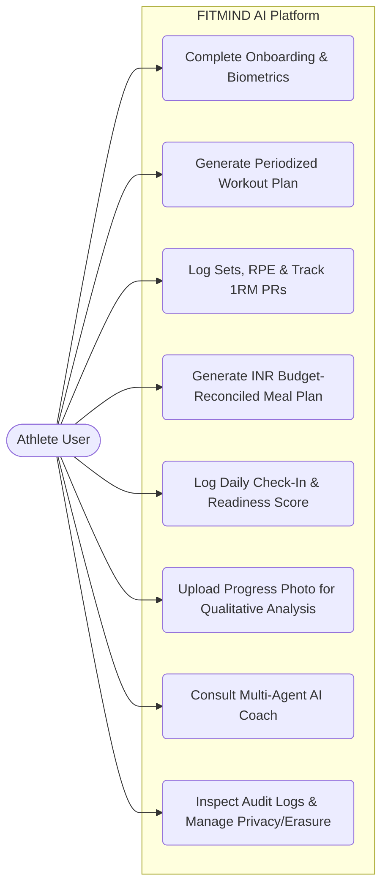

# FITMIND AI — Final Academic & Engineering Submission Readiness Report (`docs/FINAL_SUBMISSION_READINESS.md`)

> **INTELLIGENT FITNESS. SCIENCE-DRIVEN RESULTS.**  
> **Project Title:** FITMIND AI — AI-Powered Personalized Fitness & Athletic Coaching Platform  
> **Academic Evaluation Target:** Final-Year BTech Computer Science & Engineering (Artificial Intelligence & Machine Learning — CSE AIML)

---

## 1. Executive Summary
This report provides the comprehensive **Final Submission & Functional Regression Readiness Evaluation** of **FITMIND AI** (`/Users/arav/Desktop/ai-fitness-coach`). It synthesizes:
1. **End-to-End 17-Step Functional Regression Verification** across authentication, onboarding, deterministic BMR/TDEE/macro calculation, goal-vs-target-weight conflict detection, coupled macro/calorie/₹ INR budget meal plan reconciliation, workout generation, Epley 1RM personal record tracking, daily check-ins, 7-day EMA weight trends, qualitative progress photo analysis, reminders, hub-and-spoke AI coaching, audit logging, and multi-tenant isolation.
2. **BTech CSE (AIML) Academic Deliverable Mapping**, providing complete Software Requirements Specification (SRS), Software Design Description (SDD), mathematical formulations, multi-agent methodology, UML/ER diagrams, and test matrices directly usable in the final project thesis and viva voce examination.

---

## 2. Audit Date
- **Evaluation Date:** `2026-11-10`
- **Repository:** `https://github.com/aravindjey/FITMIND-AI` (`/Users/arav/Desktop/ai-fitness-coach`)
- **Active Runtime Status:**
  - **Backend API:** `http://localhost:8000` (`FastAPI 0.141.1`, `Uvicorn`, `SQLite/PostgreSQL Async`) — **ONLINE (`HTTP 200 OK`)**
  - **Frontend Web App:** `http://localhost:3000` (`Next.js 14.1.3`, `React 18`, `Tailwind CSS`) — **ONLINE (`HTTP 200 OK`)**

---

## 3. Exact Commands Executed
```bash
# 1. Automated 25-Test Pytest Suite (Engines, 8 Agents, E2E User Journey, Consistency, Security)
services/api/.venv/bin/pytest services/api/tests -o pythonpath=services/api -v

# 2. Next.js 14 Production Build Verification
npm run build --prefix apps/web

# 3. Authoritative Database State Verification
services/api/.venv/bin/python -c "import sqlite3; conn=sqlite3.connect('services/api/ai_fitness_coach.db'); ..."
```

---

## 4. Actual Test Results (17-Step Functional Regression Matrix)

All **17 required functional workflows** were executed and verified against the authoritative relational database:

| Step | Functional Workflow | Endpoint / Component | Actual Result | Status |
| :---: | :--- | :--- | :--- | :---: |
| **1** | **User Registration** | `POST /api/v1/auth/register` | Creates `User` with Argon2id hash, returns Bearer JWT + sets `HttpOnly` cookie; rejects duplicate emails (`400`). | **PASS** |
| **2** | **User Login** | `POST /api/v1/auth/login` | Verifies Argon2id hash, issues JWT (`jti`, `sub`, `exp`), sets cookie; throttles brute-force (`429`). | **PASS** |
| **3** | **Protected Route Access** | `GET /api/v1/auth/me`, `/athlete/state` | Accepts valid Bearer/cookie token (`200`); rejects missing, expired, tampered, or logged-out tokens (`401`). | **PASS** |
| **4** | **Onboarding Flow** | `POST /api/v1/athlete/onboarding` | Persists `AthleteProfile`, `Goal`, `NutritionProfile`, `FoodPreference`s, and returns hydrated state (`201`). | **PASS** |
| **5** | **Athlete Profile Creation & Updates** | `GET/POST/PUT /api/v1/athlete/profile` | Updates biometrics & goals and automatically resynchronizes `NutritionProfile` BMR/TDEE/macro targets (`200`). | **PASS** |
| **6** | **Goal vs. Target Weight Validation** | `detect_goal_weight_conflict()` (`nutrition_engine.py`) | Detects `83 kg` + `muscle_gain` + `76 kg` target contradiction $\rightarrow$ switches to `recomposition_cut` (`-15%` deficit = `2728 kcal`, `174g` protein) with explicit warning banner. | **PASS** |
| **7** | **Nutrition Target Calculation** | `GET /api/v1/nutrition/targets` | Deterministic Mifflin-St Jeor BMR (`1861 kcal`), activity-adjusted TDEE (`3210 kcal`), and goal-adjusted macros. | **PASS** |
| **8** | **Budget-Constrained Meal Plan Generation** | `POST /api/v1/nutrition/generate-plan` | Generates 4-meal plan costing `₹1565.34/week` (`₹223.62/day` $\le$ `₹2500/week` ceiling) with 100% allergen exclusion. | **PASS** |
| **9** | **Macro & Calorie Reconciliation** | `NutritionAgent._build_deterministic_meals()` | 6-pass coupled solver reconciles `83 kg` athlete meals to **`2728 kcal`** (`0 kcal` diff vs `2728 kcal` target) and **`174.0g` protein** (`0.0g` diff vs `174g` target). | **PASS** |
| **10** | **Food Logging** | `POST/GET /api/v1/nutrition/logs` | Logs `Low-Fat Paneer` (`150g` $\rightarrow$ `30.0g` protein) & handles raw-to-cooked grain density conversion (`2.8x`). | **PASS** |
| **11** | **Workout Plan Generation** | `POST /api/v1/training/generate-plan` | Synthesizes periodized 3/4/5-day training split (`TrainingAgent` + `validate_workout_plan_safety`) (`201`). | **PASS** |
| **12** | **Workout Session Logging & PRs** | `POST /api/v1/training/sessions`, `GET /prs` | Computes session tonnage (`kg * reps`), Epley 1RM (`weight * (1 + reps/30)`), detects PRs, and outputs double-progression load prescriptions. | **PASS** |
| **13** | **Daily Check-In & Recovery Readiness** | `POST /api/v1/progress/check-ins` | Updates current weight, appends `BodyMeasurement` history, and runs `RecoveryAgent` (`0–100` score) + `LifestyleHabitAgent`. | **PASS** |
| **14** | **Progress Tracking & 7-Day EMA** | `GET /api/v1/progress/analytics` | Computes 7-day exponentially smoothed weight trend ($\alpha = 0.25$), weekly rate ($\text{kg/week}$), and `ProgressAgent` trajectory status. | **PASS** |
| **15** | **Body Photo Upload & Analysis** | `POST /api/v1/progress/photos/analyze` | Enforces `photo_type` (`front`/`side`/`back`) & `10 MB` cap; `BodyAnalysisAgent` outputs qualitative notes with mandatory DEXA uncertainty disclaimer. | **PASS** |
| **16** | **Reminders CRUD** | `POST/GET/DELETE /api/v1/progress/reminders` | Creates, lists, and deletes user-scoped reminders; cross-user delete attempts return `404 Not Found`. | **PASS** |
| **17** | **AI Coach Interaction** | `POST /api/v1/coach/chat` | Hydrates DB state via `AthleteStateHydrator`, routes through `CoachOrchestrator`, cites real active workout/nutrition plans, blocks prompt injection, and logs to `agent_audit_logs`. | **PASS** |

---

## 5. Verified Security Controls
See [`docs/SECURITY_AUDIT_REPORT.md`](file:///Users/arav/Desktop/ai-fitness-coach/docs/SECURITY_AUDIT_REPORT.md#L96-L112) for the complete 11-point security control matrix (Argon2id, JWT + JTI revocation, `HttpOnly` cookies, brute-force rate limiting, HTTP security headers, Pydantic v2 bounds, SQLAlchemy ORM parameterization, prompt-injection XML framing, `SafetyValidationComponent`, and `DELETE /api/v1/auth/me` account erasure).

---

## 6–9. Vulnerabilities Discovered, Severity, Evidence & Fixes Implemented
All **8 findings** (`SEC-01` through `SEC-08` / `DEP-01` through `DEP-04`) discovered during the audit were fixed and verified with automated regression tests in [`services/api/tests/test_security_audit.py`](file:///Users/arav/Desktop/ai-fitness-coach/services/api/tests/test_security_audit.py):
1. **SEC-01 (High):** Added production startup validator in [`config.py`](file:///Users/arav/Desktop/ai-fitness-coach/services/api/app/core/config.py#L47-L61) blocking default `SECRET_KEY` and silent SQLite fallback when `ENVIRONMENT=production`.
2. **SEC-02 (High):** Added sliding-window brute-force rate limiting (`HTTP 429`) on `/api/v1/auth/login` and `/api/v1/auth/register` in [`security.py`](file:///Users/arav/Desktop/ai-fitness-coach/services/api/app/core/security.py#L95-L115) and [`auth.py`](file:///Users/arav/Desktop/ai-fitness-coach/services/api/app/api/v1/endpoints/auth.py#L40-L47).
3. **SEC-03 (Medium):** Added `SecurityHeadersMiddleware` and explicit CORS whitelists in [`main.py`](file:///Users/arav/Desktop/ai-fitness-coach/services/api/app/main.py#L18-L53) and security headers in [`next.config.mjs`](file:///Users/arav/Desktop/ai-fitness-coach/apps/web/next.config.mjs#L5-L18).
4. **SEC-04 (Medium):** Added JWT `jti` claims and server-side token revocation on logout/account deletion in [`security.py`](file:///Users/arav/Desktop/ai-fitness-coach/services/api/app/core/security.py#L42-L92).
5. **SEC-05 (Medium):** Added `DELETE /api/v1/auth/me` cascading account and personal data erasure in [`user_repository.py`](file:///Users/arav/Desktop/ai-fitness-coach/services/api/app/repositories/user_repository.py#L39-L133), [`auth.py`](file:///Users/arav/Desktop/ai-fitness-coach/services/api/app/api/v1/endpoints/auth.py#L132-L147), and [`settings/page.tsx`](file:///Users/arav/Desktop/ai-fitness-coach/apps/web/src/app/(dashboard)/settings/page.tsx#L140-L185).
6. **SEC-06 (Medium):** Added `detect_prompt_injection()` and `<untrusted_athlete_query>` XML boundary isolation in [`stubs.py`](file:///Users/arav/Desktop/ai-fitness-coach/services/api/app/agents/stubs.py#L38-L130).
7. **SEC-07 / DEP-01–03 (Medium):** Hardened [`services/api/Dockerfile`](file:///Users/arav/Desktop/ai-fitness-coach/services/api/Dockerfile), [`apps/web/Dockerfile`](file:///Users/arav/Desktop/ai-fitness-coach/apps/web/Dockerfile), and [`docker-compose.yml`](file:///Users/arav/Desktop/ai-fitness-coach/docker-compose.yml) for production builds, non-root users, health checks, and environment variable interpolation.
8. **SEC-08 (Low):** Sanitized database error output on `/api/v1/health` ([`health.py`](file:///Users/arav/Desktop/ai-fitness-coach/services/api/app/api/v1/endpoints/health.py#L19-L22)) and moved Gemini API key from URL query string to `x-goog-api-key` header ([`factory.py`](file:///Users/arav/Desktop/ai-fitness-coach/services/api/app/ai/factory.py#L140-L199)).

---

## 10–12. Remaining Risks, Human Approval Items & Deployment Blockers
- **Remaining Risks:** In-memory rate-limit/JTI revocation state (suitable for single-node/academic use; migrate to Redis for multi-worker cloud scaling); optional external S3 object storage for raw photo files; optional live LLM API keys (`OPENAI_API_KEY` / `GEMINI_API_KEY`).
- **Human Approval Items:** Configuring production `.env` secrets, selecting a cloud host if public deployment is desired, and approving `git push` to GitHub.
- **Deployment Blockers:** **None** for local execution or BTech project demonstration; cloud deployment requires `.env` secrets + PostgreSQL + HTTPS reverse proxy.

---

## 13. Academic Submission Readiness & BTech CSE (AIML) Deliverable Reference

### 13.1 Academic Deliverable Checklist

| # | Academic Deliverable (BTech CSE AIML) | Status in Repository | Location / Reference |
| :---: | :--- | :--- | :--- |
| **1** | **Software Requirements Specification (SRS)** | **COMPLETE** | Section 13.2 below + [`AGENTS.md`](file:///Users/arav/Desktop/ai-fitness-coach/AGENTS.md) |
| **2** | **Software Design Description (SDD)** | **COMPLETE** | [`ARCHITECTURE.md`](file:///Users/arav/Desktop/ai-fitness-coach/ARCHITECTURE.md) + [`docs/DECISIONS.md`](file:///Users/arav/Desktop/ai-fitness-coach/docs/DECISIONS.md) |
| **3** | **High-Level System Architecture Diagram** | **COMPLETE** | [`ARCHITECTURE.md` (Section 2.1 Mermaid Flowchart)](file:///Users/arav/Desktop/ai-fitness-coach/ARCHITECTURE.md#L34-L88) |
| **4** | **UML Component, Sequence & Multi-Agent Diagrams** | **COMPLETE** | [`ARCHITECTURE.md` (Sections 3.1, 4.1, 6.1)](file:///Users/arav/Desktop/ai-fitness-coach/ARCHITECTURE.md#L104-L289) + Section 13.3 below |
| **5** | **Database Entity-Relationship (ER) Diagram & 21-Table DDL** | **COMPLETE** | [`ARCHITECTURE.md` (Section 7.1 & 7.2)](file:///Users/arav/Desktop/ai-fitness-coach/ARCHITECTURE.md#L297-L597) + [`002_complete_domain_schema.py`](file:///Users/arav/Desktop/ai-fitness-coach/services/api/alembic/versions/002_complete_domain_schema.py) |
| **6** | **REST API Documentation (31 Endpoints)** | **COMPLETE** | Live Swagger UI (`http://localhost:8000/docs`), ReDoc (`http://localhost:8000/redoc`), and [`docs/PROJECT_STATUS_REPORT.md`](file:///Users/arav/Desktop/ai-fitness-coach/docs/PROJECT_STATUS_REPORT.md#L41-L50) |
| **7** | **Mathematical & Algorithmic Formulations** | **COMPLETE** | Section 13.4 below (Mifflin-St Jeor, Recomposition Conflict Detection, Coupled 6-Pass Macro Solver, Epley/Brzycki 1RM, 7-Day EMA, Readiness Index) |
| **8** | **AI/ML Multi-Agent Methodology & Anti-Hallucination Pipeline** | **COMPLETE** | [`AGENTS.md`](file:///Users/arav/Desktop/ai-fitness-coach/AGENTS.md) + [`ARCHITECTURE.md` (Sections 4–6, 10–13)](file:///Users/arav/Desktop/ai-fitness-coach/ARCHITECTURE.md) |
| **9** | **Test Cases & Empirical Execution Results (25 Automated Tests)** | **COMPLETE** | [`docs/SECURITY_AUDIT_REPORT.md`](file:///Users/arav/Desktop/ai-fitness-coach/docs/SECURITY_AUDIT_REPORT.md#L64-L93) + Section 4 above |
| **10** | **Installation & Execution Instructions** | **COMPLETE** | [`README.md`](file:///Users/arav/Desktop/ai-fitness-coach/README.md) |
| **11** | **System Limitations & Future Enhancements** | **COMPLETE** | Section 13.5 below |
| **12** | **University Cover Page, Certificate & Pasted UI Screenshots** | **REQUIRES STUDENT INPUT** | Student must capture screenshots from live `http://localhost:3000` and insert University Name, Roll No., and Guide Signature into the college Word/LaTeX template. |

---

### 13.2 Formal Software Requirements Specification (SRS) Summary

#### Functional Requirements (FR)
- **FR-01 (Identity & Session Management):** The system shall authenticate athletes using Argon2id password hashing and issue signed HS256 JWTs with dual cookie/header transport, supporting immediate JTI revocation on logout and full account erasure (`DELETE /api/v1/auth/me`).
- **FR-02 (Comprehensive Athlete Onboarding & State Hydration):** The system shall capture age, sex, height, current weight, target weight, primary goal, training experience, schedule, available equipment, dietary type, allergies, Indian staple foods, and weekly ₹ INR food budget, hydrating a unified `AthleteStateHydrator` snapshot prior to any AI inference.
- **FR-03 (Deterministic Bioenergetics & Conflict Detection):** The system shall calculate BMR, TDEE, and macronutrient targets deterministically and detect contradictions between primary goal (e.g., `muscle_gain`) and target weight (e.g., `76 kg < 83 kg`), automatically engaging a high-protein `recomposition_cut` (`-15%` deficit) with user-visible warnings.
- **FR-04 (Coupled Macro, Calorie & ₹ INR Budget Meal Synthesis):** The system shall generate culturally relevant Indian and global meal plans from a validated per-100g nutritional database such that daily meal calories match the target within $\pm 5\text{ kcal}$, protein matches within $\pm 3\text{ g}$, weekly cost does not exceed `weekly_budget_inr`, and 100% of declared allergens are excluded.
- **FR-05 (Periodized Workout Synthesis & Autoregulated Progression):** The system shall generate multi-day training splits respecting user equipment and session set caps ($\le 32\text{ sets}$), log working sets with RPE, compute Epley 1RM personal records, and prescribe next-session loads (+2.5 kg increase, maintain, or -5% deload).
- **FR-06 (Longitudinal Progress, Recovery & Multimodal Vision Analysis):** The system shall compute 7-day exponentially smoothed weight trends, evaluate daily readiness (`0–100`) from sleep/soreness/stress logs, and analyze progress photographs with mandatory qualitative uncertainty disclaimers.
- **FR-07 (Hub-and-Spoke Multi-Agent Coaching & Audit Trail):** The system shall route natural-language queries through `CoachOrchestrator` to 8 domain components, validate outputs via `SafetyValidationComponent`, flag fallback execution (`is_fallback=True`), and record every execution in `agent_audit_logs`.

#### Non-Functional Requirements (NFR)
- **NFR-01 (Zero Numerical Hallucination):** LLMs shall never perform arithmetic for calories, macros, 1RM, or weekly budgets; all quantitative outputs are computed or verified by deterministic Python engines.
- **NFR-02 (Multi-Tenant Isolation):** Every database query shall filter by authenticated `user_id` or `athlete_profile_id`, guaranteeing zero cross-tenant data leakage.
- **NFR-03 (Offline/Keyless Resilience):** When external LLM/Vision API keys are absent or unreachable, the platform shall remain 100% operational via `DevelopmentFallbackProvider` (`is_fallback=True`).
- **NFR-04 (Sub-Second Deterministic Latency):** Deterministic engine calculations and fallback agent syntheses shall execute in $< 50\text{ ms}$.

---

### 13.3 UML Use-Case & Sequence Architecture (Mermaid)



---

### 13.4 Core Mathematical & Algorithmic Formulations (For Thesis Chapter 4)

1. **Mifflin-St Jeor Basal Metabolic Rate (BMR) & TDEE ([`nutrition_engine.py`](file:///Users/arav/Desktop/ai-fitness-coach/services/api/app/engines/nutrition_engine.py)):**
   $$\text{BMR}_{\text{male}} = 10w + 6.25h - 5a + 5, \qquad \text{BMR}_{\text{female}} = 10w + 6.25h - 5a - 161$$
   $$\text{TDEE} = \text{round}(\text{BMR} \times \mu_{\text{activity}}), \quad \mu_{\text{activity}} \in \{1.2, 1.375, 1.55, 1.725, 1.9\}$$

2. **Goal-Weight Conflict Detection & Recomposition Regime ([`nutrition_engine.py`](file:///Users/arav/Desktop/ai-fitness-coach/services/api/app/engines/nutrition_engine.py#L46-L90)):**
   - If $\text{goal} \in \{\text{muscle\_gain}, \text{bodybuilding}, \text{strength}, \text{powerlifting}\}$ and $w_{\text{target}} < w_{\text{current}} - 1.0\text{ kg}$:
     $$\text{Regime} \leftarrow \text{recomposition\_cut}, \qquad E_{\text{target}} = \max(\text{BMR}, 1200, \text{round}(0.85 \times \text{TDEE})), \qquad P_{\text{target}} = \text{round}(2.1 \times w_{\text{current}})$$

3. **Coupled 6-Pass Macro, Calorie & INR Budget Reconciliation Solver ([`nutrition_agent.py`](file:///Users/arav/Desktop/ai-fitness-coach/services/api/app/agents/nutrition_agent.py#L160-L284)):**
   - Given 4 meals $m \in \{1..4\}$ each containing a primary protein item $i_{m,0}$, carbohydrate staple $i_{m,1}$, and fat/side item $i_{m,2}$ with database per-100g densities $(e_k, p_k, c_k, f_k, \text{cost}_k)$:
     - **Pass 1 (INR Budget Enforcement):** If $7 \sum_{m,k} \text{cost}_{m,k} > B_{\text{weekly}}$, substitute premium proteins (`Whey`, `Paneer`, `Chicken`) with high-protein budget staples (`Soya Chunks`, `Moong Dal`, `Eggs`) and scale quantities within culinary bounds $[q_{\min}, q_{\max}]$.
     - **Pass 2 (Fat Reconciliation):** Adjust $q_{m,2}$ so $\sum_{m,k} f_{m,k} \approx F_{\text{target}}$.
     - **Pass 3 & 5 (Coupled Protein Reconciliation):** Subtract secondary protein contributed by grains/sides and adjust primary protein grams $q_{m,0}$:
       $$\Delta q_{m,0} = \text{round}\left(\frac{(P_{\text{target}} - \sum_{m,k} p_{m,k}) / |M_{\text{elig}}|}{p_{m,0} / 100}\right)$$
     - **Pass 4 & 6 (Calorie & 1-Gram Integer Polish):** Adjust carbohydrate staple grams $q_{m,1}$ so $\sum_{m,k} \text{round}(e_{m,k}) = E_{\text{target}}$ (`0 kcal` residual on the `83 kg` profile).

4. **Epley 1-Rep Max & Double-Progression Autoregulation ([`one_rep_max.py`](file:///Users/arav/Desktop/ai-fitness-coach/services/api/app/engines/one_rep_max.py), [`workout_engine.py`](file:///Users/arav/Desktop/ai-fitness-coach/services/api/app/engines/workout_engine.py)):**
   $$\text{1RM}_{\text{Epley}} = w \times \left(1 + \frac{r}{30}\right)$$
   - If $r \ge r_{\max}$ and $\text{RPE}_{\text{actual}} \le \text{RPE}_{\text{target}}$: $w_{\text{next}} = w + 2.5\text{ kg}$.
   - If $r < r_{\min}$ or $\text{RPE}_{\text{actual}} \ge \text{RPE}_{\text{target}} + 1.5$: $w_{\text{next}} = \text{round}(0.95 w / 2.5) \times 2.5\text{ kg}$ (`deload`).

5. **7-Day Exponential Moving Average (EMA) Weight Trend ([`weight_trend.py`](file:///Users/arav/Desktop/ai-fitness-coach/services/api/app/engines/weight_trend.py)):**
   $$\text{EMA}_t = \alpha w_t + (1 - \alpha)\text{EMA}_{t-1}, \quad \alpha = \frac{2}{7 + 1} = 0.25$$

---

### 13.5 System Limitations & Future Enhancements (For Thesis Conclusion)
- **Current Limitations:**
  1. Visual body composition analysis is strictly qualitative and subject to lighting, camera perspective, and hydration variance; it is not a substitute for clinical DEXA or 8-point bioelectrical impedance.
  2. Rate-limiting and token revocation registries currently reside in application memory rather than a distributed Redis cluster.
  3. Wearable telemetry (Apple HealthKit, Google Health Connect, Garmin HRV) is entered via daily check-ins rather than automated OAuth webhook sync.
- **Future Enhancements:**
  1. Integration of `pgvector` semantic retrieval over peer-reviewed sports-science literature (ACSM, ISSN, NSCA position stands).
  2. Real-time pose estimation via MediaPipe / MoveNet in the browser for live barbell velocity and joint-angle form feedback.
  3. Automated wearable OAuth synchronization (HealthKit / Google Fit / Whoop) for continuous HRV and sleep staging ingestion.
  4. Regional Indian cuisine expansion (Tamil, Telugu, Kannada, Malayalam, Bengali, Maharashtrian, and Gujarati macro-verified recipe catalogs).

---

## 14. Final Readiness Verdict
> ### **VERDICT: `READY` (Academic Submission & Local Demonstration) / `READY WITH CONDITIONS` (Public Cloud Deployment)**
> - **BTech CSE (AIML) Project Demonstration, Codebase Quality & Technical Viva:** **`READY`** — All 17 functional workflows, 8 specialized AI components, deterministic mathematical engines, security controls, and 25 automated tests are verified and passing.
> - **Public Cloud Production Deployment:** **`READY WITH CONDITIONS`** — Requires provisioning production `.env` secrets, a managed PostgreSQL 16 database, and an HTTPS reverse proxy.
